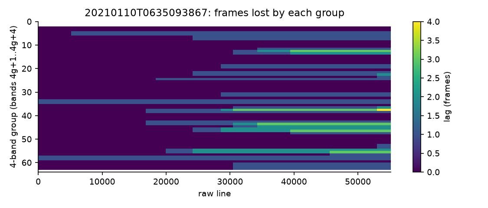
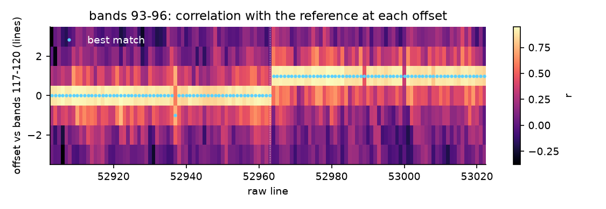
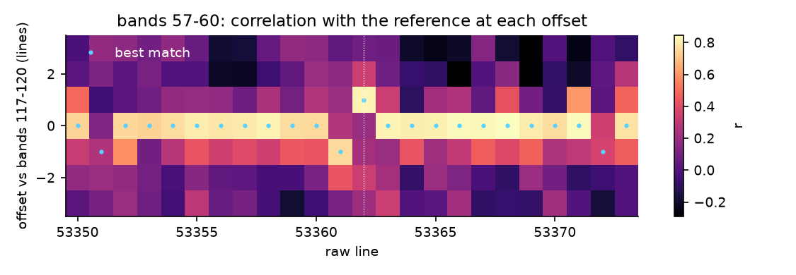
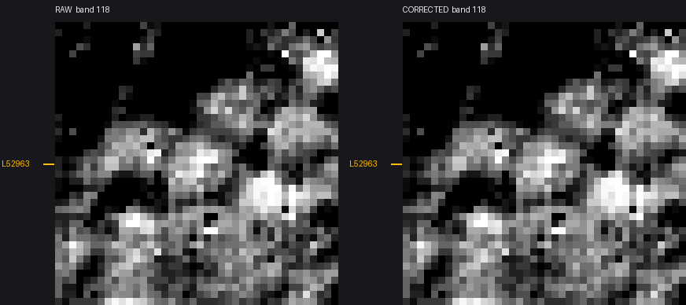
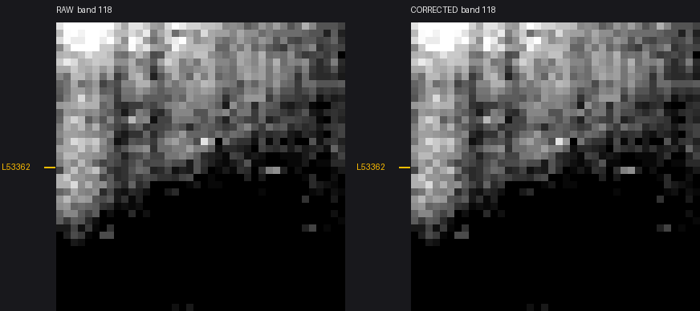
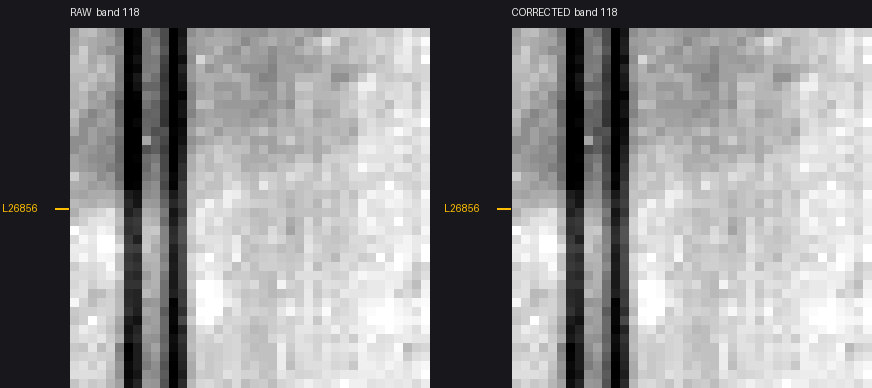

# Frame defects

IIRS L0 data lose frames independently in each group of four bands. `iirspy.frames` detects the lost frames, and `L0.calibrate` re-times the affected rows onto their true frames and rebuilds the lost pixels. The correction is on by default in the `iirspy` preset.

## Why it matters

A group that lags the rest of the detector is displaced along track by whole pixels (about 80 m) relative to the other bands. Every along-track edge, such as an albedo or shadow boundary, then puts a 4-band stair-step into the spectrum. The lag also blurs band 54, the band used for AROSICS georeferencing.

## Defects

The detector's 256 bands are read out in 64 groups of 4, group `g` (0-based) holding 1-based bands `4g+1` to `4g+4`. Each group can lose frames independently and nothing in the DN marks it. The description below is our interpretation of the raw `nri` L0 data. The ISSDC calibrated `nci` data carry the same defects uncorrected, and ISSDC fills black stripes by duplicating neighbouring rows.

- Drop. From one exact line on, raw row `y` of the group holds true frame `y + lag`. Lags only accumulate and never reverse. Groups often drop together, in 8-band pairs or several groups at one line. The end of the strip is padded by repeating the last line, once per drop. Drops do not propagate to other bands and their spacing is irregular. In a 78-scene sample, 29 scenes (about 37%) have drops, more often in long south-pole strips.
- Overwrite. Two frames `y` and `y+1` are lost and refilled from both sides (A A B B). Row `y` repeats frame `y-1` and row `y+1` holds frame `y+2`, one row early. Timing is unchanged outside those two rows. The copies are exact or within 1 DN in one band. About 1,700 events in one scene were checked and all had this structure.
- Black stripe. Four all-zero rows in one group while the rest of the detector has signal.

Scene 20210110T0635093867 (north polar strip, 55174 lines) has 6,647 paired overwrites, 821 lone copies and 27 black stripes, all exactly 4 rows. For a lone copy the partner row is more than 1 DN off, so A and B cannot be told apart. Rows `y-2` to `y+1` are masked instead, a known simplification.

A separate fixed cross-track spectral tilt of +0.5 to -0.8 px across bands is not keystone. It is not corrected by this step.



Figure 1: Lag in frames of each of the 64 four-band groups along scene 20210110T0635093867. Lags accumulate to 4 frames by the end of the strip.



Figure 2: Correlation of bands 93-96 against reference bands 117-120 at offsets -3 to +3 per raw line around line 52963. The best match steps from 0 to +1 at line 52963 and stays there, which is a drop. The single -1 blip near line 52937 is an unrelated overwrite.



Figure 3: The same correlation for bands 57-60 around line 53362. The best match is 0 everywhere except row 53361 at -1 (a copy of row 53360) and row 53362 at +1 (frame 53363), so timing is unchanged outside the two lost rows.

## Detection

`iirspy.frames.build_table` makes one streamed pass over the whole raw cube. It builds a cross-track high-passed, normalised line profile for each group, then matches each group line by line against a reference group at offsets -5 to +5. The reference is bands 117-120 for reflected light and bands 201-204 for the thermal block (bands 173-252).

A stride-4 pre-screen in 1000-line windows finds where the offset changes. Only those windows are matched per line, and change points are fitted jointly across groups. A drop in the reference group shows as most other groups stepping -1 together and is credited to the reference. Lags only accumulate, so each block is anchored with its least-lagged groups at 0.

Overwrites and black stripes come from exact or near-exact row repeats and all-zero rows. Fully shadowed rows cannot be matched and do not need to be. Low-SNR groups whose start offset cannot be decided are left at 0 and flagged with value `None`. A strip takes 40-140 s, mostly zip decompression, of which detection is 2-20 s.

### Offsets table

The table is `<sid>_frames_offsets.csv`, one per strip. `L0.calibrate_to_rad` with `fix_frames` builds it from the full cube on first use and caches it beside the `.qub`, or takes an existing table as `frame_offsets`. A band-subset cube cannot be scanned; pass a table built from the full cube or zip with `iirspy.frames.build_table`. `iirs-solve-scene` keeps it beside the strip's GCPs and `_L1_b54.tif` in the geometry/recalibrated day directory, shared by all CRS groups.

Table 1: Columns of `<sid>_frames_offsets.csv`.

| Column | Content |
|---|---|
| `kind` | `start`, `drop`, `overwrite` or `black`. |
| `line` | Raw line of the event. |
| `group` | Band group, 0-based. |
| `bands` | Band range of the group, 1-based. |
| `value` | For `start` and `drop`, the lag change at that raw line (`None` is an undetermined start). For `overwrite` and `black`, the number of raw rows from that line that hold no valid frame. |

Example rows from scene 20210110T0635093867:

```
kind,line,group,bands,value
start,0,33,133-136,1
drop,30480,13,53-56,1
overwrite,53361,14,57-60,2
black,26856,19,77-80,4
```

## Correction

The fields `fix_frames` and `fill_frames` of `L1Config` are both on in the `iirspy` preset and off in `issdc`. The table is passed as `L0.calibrate(..., frame_offsets=path)`.

1. Re-time (`fix_frames`): each group's rows move to their true frame, raw row `y` to frame `y + lag`. This is a pure re-index and no values are interpolated. Lost frames (the dropped frame, overwrite rows, black rows) become NaN.
2. Fill (`fill_frames`): each lost pixel is rebuilt from its own spectrum and its neighbours' spectral shape. The hole is bridged linearly between the nearest kept bands on either side at the same pixel. The bridge is then multiplied by the ratio of the nearest kept rows above and below (within 6 rows) to their own linear bridge, which restores the curvature of any absorption inside the gap. Holes spanning more than 9 bands, or with no kept neighbouring row, stay NaN and fall to `interp_bands`. That step also still handles OSF/invalid bands and bad pixels, where no neighbouring row has the band.

The fill was chosen by punching artificial 4-band holes into lit pixels of good data (groups 4-39) in 4 scenes and refilling them. Holes are under 1% of the rows in a strip. The single-band noise floor is about 1.8-1.9%, which no method can beat.

Table 2: Median absolute relative error of refilled artificial holes, range over the 4 scenes.

| Hole height | Along-track interpolation | Linear across bands (`interp_bands`) | Hybrid (shipped) |
|---|---|---|---|
| 1 row (drop) | 4.4-6.3% | 2.6-4.1% | 1.9-3.9% |
| 2 rows (overwrite) | 5.0-6.7% | 2.6-3.9% | 1.9-3.8% |
| 4 rows (black) | 5.8-8.1% | 2.6-4.0% | 2.0-3.9% |

In 3 of the 4 scenes the hybrid is at the noise floor (1.9-2.3%) for every hole size. The fourth scene, 20230109, is high for every method. Linear interpolation across bands misses any absorption inside the roughly 80 nm gap. Along-track interpolation discards the pixel's own, correctly placed spectrum.



Figure 4: Band 94 at line 52963 against reference band 118, raw (left) and corrected (right), 40x40 px at 9x nearest-neighbour zoom. After re-timing, the drop no longer displaces the band, and the lost row is magenta.



Figure 5: Band 58 at lines 53361-53362 against reference band 118, same layout as Figure 4. The two overwritten rows are lost and shown magenta after correction.



Figure 6: Band 78 at line 26856 against reference band 118, same layout as Figure 4. The four zero rows are lost and shown magenta after correction.

## Pipeline behaviour

- `iirs-solve-scene` builds the table once per strip before any other processing if it is missing. It streams the `nri` zip with no staging, since the staged cube holds only the solve's bands, and caches the table. Every later task and CRS group reuses it.
- A solve whose merged GCPs are older than the table is re-solved on the re-timed cube. The L1 cache and the per-chunk solve cache are keyed on the table's content hash. The chunk reference hillshades and WAC images do not depend on the cube and are reused from the work dir.
- `iirs-compute-refl` refuses to run on GCPs that predate the table. Re-run the solve first.
- GLT, LOC and L2 products are in true-frame coordinates. ISSDC products (`nri`, `nci`, `ndi`) still carry the defects.

## Repairing any product

`iirs-fix-frames <sid> --product nri|nci|ndi --out f.tif [--fill-frames]` loads the ISSDC cube of that level, applies `IIRSData.fix_frames` (the same `frames.apply`/`frames.fill` as the pipeline) and writes it in nci camera order. The table is built from the nri or nci cube when absent; an ndi cannot supply one, so it needs the table from an earlier run. The ndi is repaired as shipped: lost frames are NaN (or filled), its spectral smoothing and baked-in per-row terms are not corrected.
